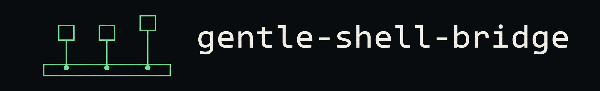

# gentle-shell-bridge

One interception layer between gentle-shell and the plugins that want a line in its menus, a card
in its rail, or a frame in the transcript.

## What It Does

gentle-shell builds its `/gentle:customize` menu, its sidebar, and its card frames inside closures
that no plugin can reach. A plugin that wants a settings row therefore has to wrap the host, patch
it, and hopefully survive the next release. Two plugins doing that do not compose: the inner
wrapper wins the capture, the outer one gets nothing, and the menu silently loses a plugin's rows.

This package owns that interception exactly once. A plugin registers what it contributes — settings
rows, a sidebar section, a card style, a transcript transform, a card design for one tool — and the
bridge turns those registrations into what the host draws. The plugin keeps its own state; the
bridge keeps the only wrapper.

What changes for a user: every installed plugin's settings appear in the one menu they already
open, and a plugin whose surface cannot be reached says why in `/bridge-status` instead of
disappearing.

## Quick Start

Add the published package next to gentle-shell and restart Pi. Inside an existing Pi:

```bash
pi install npm:gentle-shell-bridge
```

The standalone `gentle-shell` launcher keeps its own home and its own package list, so install
it there too when that is the shell you open:

```bash
gentle-shell install npm:gentle-shell-bridge
```

A launcher flag goes before the subcommand: `gentle-shell --link install npm:gentle-shell-bridge`
installs into `~/.pi/agent` instead of the isolated home — the same list `pi` writes when you
run `--link` as your default.

Pi reads the `pi` manifest and loads `src/extension.ts`. The shipped artifact is the TypeScript
source — Pi loads it through jiti, so there is no build step and no `dist/`.

Working from a checkout instead? Point Pi's package list at the directory; nothing else changes.

## Core Workflow

A plugin reaches the bridge from its own `session_start`, through the published object or through
the announcement event if the bridge loaded later. It then registers what it contributes and keeps
the disposer, so a `/reload` replaces its registration instead of stacking a second one.

A registration is evaluated when a menu is built, not when it is made, so rows always reflect live
state. Anything a registration throws is isolated to that registration and reported: one broken
plugin costs its own rows, never the menu.

Every call, its arguments and its guarantees live in the contract, linked below.

## Key Features You Should Know About

- **Settings rows** for the host's categories, or a page of your own: toggles, button rows, and the
  host's own `●`/`○` marker, arrow handling and footer for a focused row — `←/→ choose · Enter apply`
  — so a plugin never draws chrome of its own. A provider can place its block at the start of its
  category, at the end (the default), or right after another provider's rows (`placement`), and order
  it inside that slot with `order`; naming either field opts in, while a provider naming neither keeps
  the old tail append. Anchors are bridge provider ids, never host row labels; an `after` anchor is
  followed where its provider really sits — inside its category when opted in, or in the tail when it
  did not opt in. Opted-in blocks follow each row's actual category (one block per category when rows
  override it), while an unopted provider keeps its tail block, so a rendered `choice.setting` pair
  never splits. `/bridge-status` reports the landing the last build actually produced.
- **Sidebar sections** that join the rail where the plugin asks — at the start, at the end (the
  default, after every native card), or right after another section or one of the host's own cards —
  each contributing its own visibility toggle automatically. The order inside one place never depends
  on load order, and `/bridge-status` says where every card really landed and why.
- **Card styles** and **transcript transforms**: the bridge rewrites frames the host already drew,
  so the rest of the visual system stays the host's.
- **Card designs per tool name**, behind one `pi.registerToolRenderer` resolver for the whole
  process, so two plugins cannot stack wrappers on the same tool.
- **A namespaced store** for whatever a plugin wants to persist, with the bridge's own files kept
  apart from the host's.

## Documentation

| Your task | Start here |
| --- | --- |
| Call any `register*` correctly, and know what each one guarantees | [docs/contract.md](docs/contract.md) |
| Understand how the bridge reaches a sealed host, and why it is done this way | [docs/architecture.md](docs/architecture.md) |
| Know what the bridge persists, and where | [docs/state.md](docs/state.md) |
| See a real consumer, end to end | [examples/bash-card.ts](examples/bash-card.ts) |
| Read the requirements and the reason each one exists | [PRD.md](PRD.md) |
| Teach a plugin author — human or agent — to build one against this bridge | [skills/gentle-shell-bridge-plugins/SKILL.md](skills/gentle-shell-bridge-plugins/SKILL.md) |

## Limits

- **No upstream hook exists.** The bridge depends on gentle-shell internals. The day the host
  changes how it builds its menus, the fix belongs here in one place — but it is still a fix
  against internals, not a supported extension point. If Pi or gentle-shell ever ships a
  row-provider hook, this package should shrink to a thin adapter over it.
- **The capture is heuristic.** Rows are recognised by shape, inside one synchronous factory call,
  and the `Array.prototype.map` patch is restored in a `finally`. A menu built differently produces
  no capture, and `/bridge-status` reports that instead of passing silently.
- **`Keymaps` stays reserved for row providers.** The host's keymap page captures keys and claims a
  footer, so rows there would be advertised as assignable and could never honour it.
- **Row placement needs the captured host array.** The hook registry never exposes it, so there the
  bridge orders each category by `order`/`id` and `/bridge-status` reports that `start`/`after` could
  not be honoured; it never pretends to know where a host row is.
- **A section is placed at the granularity of the host's rail PARTS.** The host's own status cards
  (`CHANGES`, `STATS`, `INTEGRATIONS`) are built inside a closure the bridge cannot reach, so
  "after a status card" is not offered; a `placement` names a section or one of `todo`, `jobs`,
  `agents`, `footer`.
- **Card styles and transforms are repaints, not host features.** They depend on the host's frame
  grammar, and a downstream post-processor that re-frames the conversation can still override the
  result.
- **Tests run against a fake host.** The suite covers the public API and the extension entry
  against a fake menu, a fake rail and a fake transcript that model the host's shapes; the real TUI
  is where a change is finally seen.

## Releasing

Versions are cut from a tag: preflight checks that the tag equals the manifest version, runs the
tests and the typecheck, and prints the exact tarball; publication goes through npm Trusted
Publishing with no token anywhere; verification reads the registry back and fails if `latest` is
not the version that was tagged. A published version is immutable, so a mistake is fixed forward
with the next version.

## Next Steps

- Read the contract's first section, then register a row against the fake host in a scratch
  extension before touching a real one.
